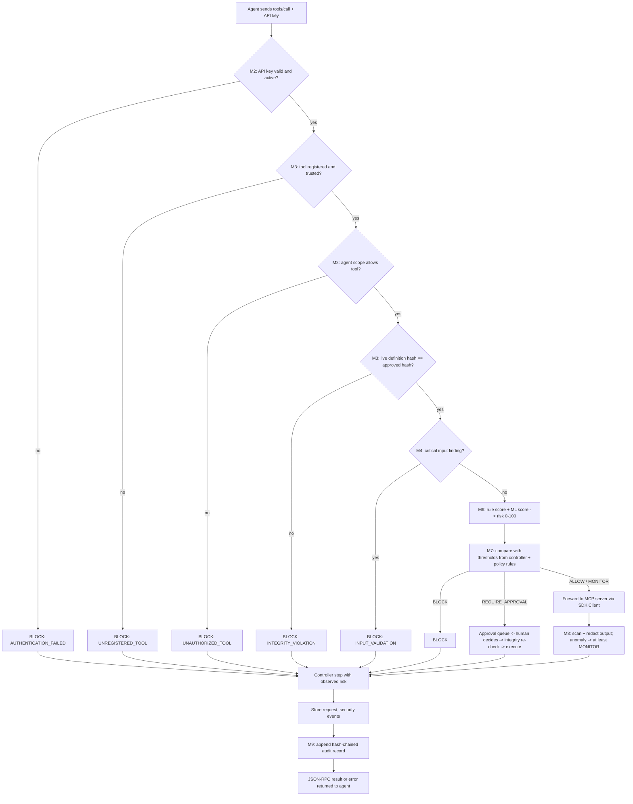

# MCP-Sentinel – Architecture

## 1. System architecture

```
                         ┌──────────────────────────────────────────────────────────────────┐
                         │                         MCP-SENTINEL (FastAPI)                     │
 ┌───────────────┐       │                                                                    │
 │  AI agents /  │ JSON- │  M1 Gateway pipeline (app/gateway.py)                              │
 │  MCP clients  │ RPC   │  ┌──────┐ ┌────────┐ ┌──────────┐ ┌──────────┐ ┌─────────────┐     │
 │ (X-API-Key)   ├──────►│  │ M2   │►│ M3     │►│ M2 scope │►│ M3 hash  │►│ M4 input    │     │
 └───────────────┘ /mcp  │  │ auth │ │registry│ │ (RBAC)   │ │ integrity│ │ validation  │     │
                         │  └──────┘ └────────┘ └──────────┘ └──────────┘ └──────┬──────┘     │
                         │                                                       ▼            │
                         │  ┌──────────────┐  thresholds  ┌──────────────┐ ┌───────────────┐  │
                         │  │ PI feedback  ├─────────────►│ M7 policy    │◄┤ M6 risk engine│  │
                         │  │ controller   │  + mode      │ engine       │ │ rules + ML    │  │
                         │  └──────▲───────┘              └──────┬───────┘ └───────────────┘  │
                         │         │ observed risk               │ ALLOW/MONITOR              │
                         │         │                             ▼                            │
                         │  ┌──────┴───────┐   output     ┌──────────────┐   MCP (SDK Client) │      ┌──────────────────┐
                         │  │ M8 behaviour │◄─────────────┤ forwarder    ├────────────────────┼─────►│ trusted MCP      │
                         │  │ monitor      │              └──────────────┘                    │      │ servers (SDK     │
                         │  └──────┬───────┘                                                  │      │ MCPServer):      │
                         │         ▼                                                          │      │ filesystem, util,│
                         │  ┌──────────────┐  ┌──────────────┐  ┌──────────────────────────┐  │      │ crm              │
                         │  │ M9 audit log │  │ approvals    │  │ M5 sandbox (subprocess)   │  │      └──────────────────┘
                         │  │ SHA-256 chain│  │ queue (M7)   │  │                           │  │
                         │  └──────────────┘  └──────────────┘  └──────────────────────────┘  │
                         │                 SQLite (SQLAlchemy)                                 │
                         └───────────────▲──────────────────────────────────────────────────┘
                                         │ REST /api (JWT, RBAC)
                         ┌───────────────┴───────────────┐
                         │ M10 React dashboard (Vite)     │
                         └────────────────────────────────┘
```

**Deployment:** two local processes, `uvicorn` (port 8000) and the Vite dev server (port 5173, which
proxies `/api` and `/mcp` to the backend). The three MCP servers run inside the backend process
and are reached through the official SDK's in-process transport with a full MCP handshake.

## 2. Data flow diagram (one `tools/call`)



Text version: request → authenticate → registry → scope → integrity → validation → risk →
policy → (forward → output monitor | approval queue | block) → controller feedback →
persistence → audit → response.

## 3. Module descriptions

### M1 – Security Gateway (`app/gateway.py`, `app/routers/gateway.py`)
Receives JSON-RPC 2.0 requests on `POST /mcp` (`tools/list`, `tools/call`). Tool names are
`server.tool`. Runs the pipeline above and returns either the MCP `CallToolResult` (with a
`_meta.sentinel` block explaining the decision) or a JSON-RPC error (codes −32001 auth,
−32002 policy, −32003 integrity, −32004 approval required, −32602 invalid input).

### M2 – Identity and Access Management (`security/auth.py`)
* **Agents**: API keys; only `SHA-256(key)` is stored. Revoked agents are rejected. Each agent has
  a least-privilege scope list (`fnmatch` patterns such as `filesystem-server.*`).
* **Dashboard users**: PBKDF2-HMAC-SHA256 password hashes (salted, 600k iterations), HS256 JWTs with
  pinned algorithm and expiry; the signing key is random per installation.
* **RBAC**: `viewer` (view), `analyst` (+ demos, approvals, audit verification, sandbox,
  experiments), `admin` (+ integrity management, tampering demos, configuration, reset).

### M3 – Server and Tool Integrity (`security/integrity.py`)
Tool definitions (`name`, `description`, `inputSchema`, `outputSchema`, `annotations`) are
canonicalised (sorted keys, no whitespace) and hashed with SHA-256. Approved hashes are captured at
installation. Before each call the live `tools/list` response is hashed and compared; mismatches
(e.g. tool poisoning in the description) block the call and show a field-level diff. Unregistered
"shadow" tools are reported. Admins can approve a new definition after review.

### M4 – Input Validation (`security/validation.py`)
JSON-Schema validation against the **approved** schema plus regex detectors applied recursively to
all strings: path traversal, sensitive system paths, command chaining/substitution, SQL injection,
null bytes (critical); SQL comments and prompt-injection phrases (high); encoded blobs,
exfiltration URLs, oversized strings/payloads (medium). Critical findings always block.

### M5 – Sandbox Simulation (`security/sandbox.py`)
Five fixed scenarios (safe computation, file escape, network exfiltration, process spawn,
infinite loop) run in a separate `python -I -S` process with an empty temp directory, minimal
environment, 3-second timeout and a PEP 578 audit hook that denies file access outside the
sandbox, sockets and process creation. No user-supplied code is ever executed.

### M6 – Risk Engine (`security/risk_engine.py`, `ml/`)
* **Rule-based score** (always computed): weighted, explainable factors – tool sensitivity
  (5/15/30), input findings (critical 40, high 25, medium 10 each, capped), large payload (10),
  bulk access (25), agent block history (30 × ratio), request rate (10/20), agent trust (0/5/15),
  recent output anomalies (5 each, max 15); capped at 100.
* **ML score**: scikit-learn `StandardScaler + LogisticRegression` on 10 features, trained on a
  **synthetic** reproducible dataset (4 000 samples, 5 % label noise). Output = P(malicious) × 100.
* **Final score**: configuration A = rule score; B and C = 0.6 × rule + 0.4 × ML.
  Every response lists each factor's points and both scores separately.

### M7 – Policy Enforcement (`security/policy.py`)
Threshold bands map the score to ALLOW < MONITOR < REQUIRE_APPROVAL < BLOCK. Invariants:
critical violations are always BLOCK (non-overridable); policy rules and the controller can only
escalate. Rules: bulk access to a high-sensitivity tool → approval; ELEVATED → high-sensitivity
tools monitored; LOCKDOWN → high-sensitivity tools and suspicious monitored requests need approval.
Approved requests re-check tool integrity before execution (prevents time-of-check/time-of-use attacks).

### M8 – Behaviour Monitoring (`security/monitor.py`)
Scans tool output for secrets (redacted before reaching the agent), prompt injection, exfiltration
URLs, sensitive paths, stack traces and oversized output. Any anomaly escalates to at least MONITOR,
creates a security event and raises the controller observation to ≥ 0.5 / 0.7.

### M9 – Tamper-Evident Audit Logging (`security/audit.py`)
Every decision (and logins, approvals, integrity checks, configuration changes, sandbox runs)
is appended with `record_hash = SHA-256(canonical(seq, timestamp, request_id, event_type, actor,
action, risk_score, details, prev_hash))`. `verify_chain` recomputes all hashes and links and
reports the first broken record (modification, deletion or reordering). The demo edits a row
directly in SQLite to show detection, and can undo the edit.

### M10 – Security Dashboard (`frontend/`)
Pages: Overview (KPIs, decisions by action, risk distribution, per-request risk vs thresholds,
controller state, integrity status, security events, audit verify button), Demo Scenarios,
Gateway & Requests (playground, agents, request log), Approval Queue, Tool Integrity, Audit Log,
Controller, Sandbox, Experiments. All values come from the API; pages auto-refresh.

## 4. Control-theoretic mechanism

Discrete-time, event-driven PI controller (one step per request), `security/controller.py`:

| Symbol | Meaning | Value / bound |
|---|---|---|
| rₖ | observed risk of request k (score/100; 1.0 for critical violations; ≥0.7 for high output anomaly) | [0, 1] |
| x̂ₖ = α rₖ + (1−α) x̂ₖ₋₁ | estimated security state (first-order low-pass observer) | α = 0.3 |
| eₖ = x̂ₖ − r* | error vs setpoint | r* = 0.18 |
| Iₖ = clamp(Iₖ₋₁ + eₖ) | integral with conditional-integration anti-windup | [−0.5, 3.0] |
| uₖ = clamp(Kp eₖ + Ki Iₖ) | control signal | Kp = 1.5, Ki = 0.12, u ∈ [−0.25, 1.0] |
| Tᵢ = clamp(Tᵢ,base − gᵢ uₖ) | adaptive thresholds | monitor 30 (g 15, 15–35), approval 55 (g 15, 40–60), block 85 (g 13, 72–88) |
| mode | NORMAL (u<0.15), ELEVATED (≥0.15), LOCKDOWN (≥0.45) | |

**Stability/boundedness:** every state variable and output is clamped, so thresholds remain in
their ranges for any input sequence (bounded-input bounded-output by construction; verified by
`test_controller_is_bounded_for_any_input_sequence` over 5 000 random inputs including
out-of-range values). Threshold ranges do not overlap, so ordering monitor < approval < block
always holds. Anti-windup is verified by `test_anti_windup_limits_recovery_time` (recovery in
< 100 calm requests after 10 000 saturated steps).

**Why the setpoint is 0.18:** the measured mean observed risk of benign traffic is ≈ 0.15; the
setpoint sits just above it so the controller relaxes slightly in calm periods and tightens when the
smoothed risk rises. Gains were selected using a documented sensitivity analysis
(see `docs/results/experiment_results.md`). This is a heuristic, interpretable controller – no
formal plant model or optimal-control claim is made.

**Configurations compared:** A static thresholds (rule score), B rule + ML with static thresholds,
C rule + ML with controller-driven thresholds and enforcement modes.
