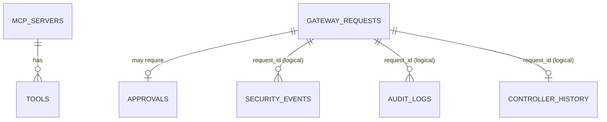

# Database schema

SQLite database `backend/data/sentinel.db`, created automatically on first start by SQLAlchemy
(`backend/app/models.py`). Delete the file (with the backend stopped) or call
`POST /api/admin/reset` to recreate it with demo data.

| Table | Purpose | Key columns |
|---|---|---|
| `users` | Dashboard users (M2) | `id` PK, `username` unique, `password_hash` (PBKDF2), `role` (admin/analyst/viewer), `is_active`, `created_at` |
| `agents` | MCP clients (M2) | `id` PK, `name` unique, `api_key_hash` (SHA-256, unique), `api_key_prefix`, `trust_level`, `allowed_tools` JSON, `is_active`, `description` |
| `mcp_servers` | Trusted server registry (M3) | `id` PK, `name` unique, `description`, `transport`, `is_trusted` |
| `tools` | Approved tools (M3) | `id` PK, `server_id` FK→mcp_servers, `name`, `sensitivity`, `approved_definition` JSON, `approved_hash`, `current_definition` JSON, `current_hash`, `integrity_status` (trusted/modified/missing), `last_checked`, `approved_by`, `approved_at` |
| `gateway_requests` | Every tool call + decision (M1/M6/M7) | `id` UUID PK, `created_at`, `source`, `agent_name`, `server_name`, `tool_name`, `arguments` JSON, `rule_score`, `ml_score`, `risk_score`, `action`, `status`, `violation`, `reasons` JSON, `risk_factors` JSON, `validation_findings` JSON, `output_findings` JSON, `thresholds` JSON, `security_mode`, `controller_mode`, `response_preview`, `latency_ms` |
| `security_events` | Notable observations (M8 and others) | `id` PK, `created_at`, `request_id`, `event_type`, `severity`, `source_module`, `message`, `details` JSON |
| `approvals` | Human approval queue (M7) | `id` PK, `request_id` FK→gateway_requests, `agent_name`, `server_name`, `tool_name`, `arguments` JSON, `risk_score`, `reasons` JSON, `status` (pending/approved/rejected), `decided_by`, `decided_at`, `decision_note`, `result_preview` |
| `audit_logs` | Hash-chained audit trail (M9) | `seq` PK (1,2,3…), `timestamp` (ISO string, hashed verbatim), `request_id`, `event_type`, `actor`, `action`, `risk_score`, `details` JSON, `prev_hash`, `record_hash` |
| `controller_state` | Single row: current controller state | `estimated_risk`, `integral`, `last_error`, `control_signal`, `monitor/approval/block_threshold`, `enforcement_mode`, `security_mode` (A_STATIC/B_ML/C_CONTROLLER), `step`, `updated_at` |
| `controller_history` | One row per controller step | `step`, `request_id`, `observed_risk`, `estimated_risk`, `error`, `integral`, `control_signal`, thresholds, `enforcement_mode` |
| `sandbox_runs` | Sandbox results (M5) | `scenario`, `outcome`, `expected_outcome`, `duration_ms`, `output`, `blocked_operation`, `run_by` |
| `experiment_runs` | Stored A/B/C comparison results | `seed`, `results` JSON, `run_by`, `created_at` |

Audit hash: `record_hash = SHA-256(json.dumps({seq, timestamp, request_id, event_type, actor,
action, risk_score (rounded to 2 decimals), details, prev_hash}, sort_keys=True,
separators=(",", ":")))`; the first record's `prev_hash` is 64 zeros.

Other files in `backend/data/`: `jwt_secret.key` (random signing key), `risk_model.joblib`
(trained classifier), `risk_model_metrics.json`, `audit_tamper_demo_backup.json` (only used by
the tampering demo's undo function).
